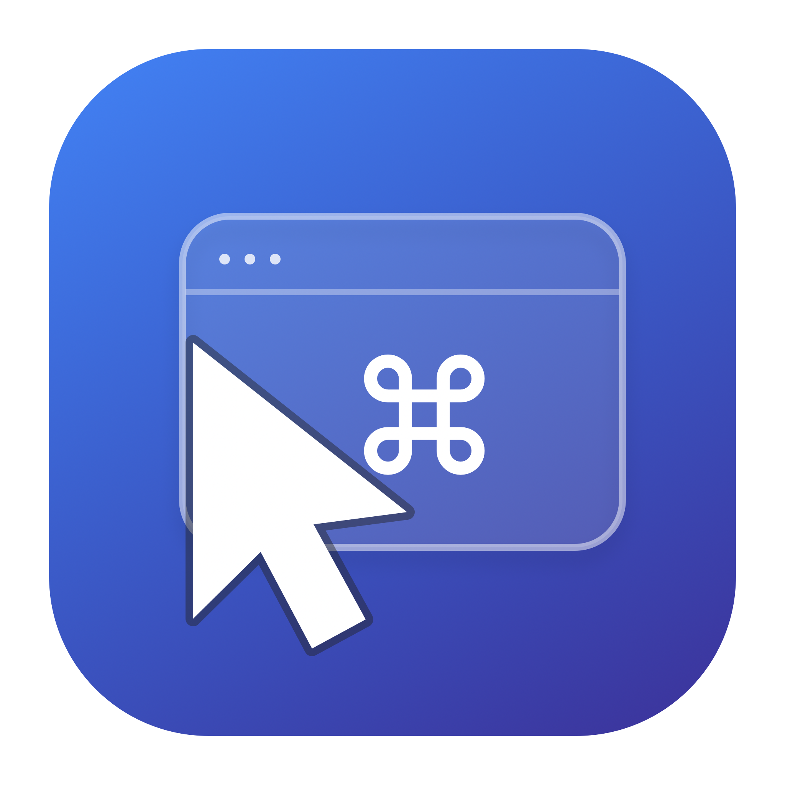

<p align="center"></p>

# HoverKeys

Control the app or window under your pointer with familiar Mac shortcuts in the Dock and Mission Control.

[English](#english) · [简体中文](#简体中文) · [Download / 下载](https://github.com/hafteeway/hoverkeys/releases/latest)

## English

### What it does

HoverKeys runs in the menu bar. Hover over a running app's Dock icon or a window preview in Mission Control, then press a shortcut.

| Shortcut | Action | Target |
| --- | --- | --- |
| `⌘Q` | Request a normal app quit | App under the pointer |
| `⌘W` | Close the entire window | Hovered preview, or the app's recently focused window from the Dock |
| `⌘M` | Minimize the window | Same window selection as `⌘W` |
| `⌘H` | Hide the app | App under the pointer |

Settings include a master switch, individual shortcut switches, permission status, and Launch at Login. Preferences persist between launches. Closing Settings keeps the app running in the background.

### Requirements

- The downloadable 0.2.0 build requires an Apple Silicon Mac.
- The build targets macOS 14 or later. Runtime checks were performed on macOS 27.2. Earlier versions and Intel builds have not been verified.
- Accessibility permission is required to identify windows, intercept the supported shortcuts, and perform window actions.

### Install

1. Download `HoverKeys-0.2.0-macos-arm64.zip` from [Releases](https://github.com/hafteeway/hoverkeys/releases/latest) and unzip it.
2. Move `HoverKeys.app` to Applications before opening it. Keep one installed copy.
3. Open the app. This release is ad-hoc signed and has not been notarized by Apple. If macOS blocks it, review the notice in **System Settings → Privacy & Security** and use **Open Anyway** only if you trust the downloaded app.
4. In **System Settings → Privacy & Security → Accessibility**, add the installed HoverKeys and enable it.
5. Open **Settings** from its menu bar icon. Confirm that Accessibility is granted and the background status is active.

If an older copy remains in Accessibility and the app still reports no permission, remove the old entry, add the copy in Applications, then reopen HoverKeys.

The public build uses the bundle identifier `app.hoverkeys.HoverKeys`. A locally installed prototype with a different identifier requires separate Accessibility approval. Quit the prototype before running this build.

### Use and configure

- Hover over the target and briefly let the pointer settle before pressing a shortcut.
- In Mission Control, point at an individual window preview. The desktop/Spaces strip is not an application target.
- From the Dock, window actions use the focused, main, or first available window of that app. HoverKeys cannot choose a particular window from the icon alone.
- Open the menu bar **Settings** item to enable or disable individual shortcuts.
- **Launch at Login** is enabled on the first run. You can switch it off in Settings. If macOS asks for approval, open **System Settings → General → Login Items** and allow HoverKeys.
- Use **Done** or close the Settings window to continue in the background. Use **Quit HoverKeys** in the menu to stop it.

`⌘W` closes a whole window, including its tabs. `⌘Q` requests normal termination, so an app may display a save prompt or decline to quit. Finder quit requests pass through to macOS. Shortcuts that HoverKeys cannot associate with a supported target pass through to the system.

### Troubleshooting and compatibility

| Symptom | What to check |
| --- | --- |
| No shortcut response | Confirm the master switch and shortcut switch are on, Accessibility is granted, and only one copy is running. |
| Permission enabled but status inactive | Remove the stale Accessibility entry and add the installed app again, then reopen it. |
| Works in Dock but not Mission Control | Let the overview animation finish and hover over an individual window preview. Window identification depends on macOS internals and can change after an OS update. |
| Does not start after login | Check Launch at Login and the system's Login Items approval. |
| Window stays open | Check for a save dialog, a disabled close button, or an app that does not expose the required Accessibility action. |

Mission Control support uses a private window-number interface and system overlay attributes. Multiple Spaces, full-screen layouts, and future macOS releases may require additional compatibility work. Login startup registration was verified, but a complete logout/reboot cycle was not tested for 0.2.0.

### Privacy

HoverKeys has no network requests, accounts, analytics, or cloud service. It uses local Accessibility information and keyboard events to implement the shortcuts. Preferences are stored with macOS UserDefaults.

Version 0.2.0 also writes a local diagnostic snapshot to `/private/tmp/hoverkeys-status.json`. It includes permission/listener state, pointer coordinates, the detected app name, the latest action status, and the app's installation path. It is updated while HoverKeys is running. Quit the app and remove this file if you want to clear it.

### Build from source

Install Xcode Command Line Tools and run the following from the repository directory.

```bash
./scripts/build.sh
```

The script creates `build/HoverKeys.app` for the build machine's architecture and applies an ad-hoc signature. It uses the macOS SDK's AppKit, SwiftUI, ApplicationServices, and ServiceManagement frameworks. No third-party packages are required.

### Uninstall

Disable **Launch at Login**, choose **Quit HoverKeys**, then move the app to Trash. Remove its entry from Accessibility. You can also delete `/private/tmp/hoverkeys-status.json` after quitting.

## 简体中文

HoverKeys 是一个菜单栏工具。将指针悬停在 Dock（程序坞）中的运行中应用图标，或 Mission Control（调度中心）的窗口预览上，即可用快捷键操作对应应用和窗口。

### 功能与快捷键

| 快捷键 | 功能 | 操作目标 |
| --- | --- | --- |
| `⌘Q` | 请求普通退出应用 | 指针对应的应用 |
| `⌘W` | 关闭整个窗口 | 调度中心的目标窗口，或 Dock 应用最近获得焦点的窗口 |
| `⌘M` | 最小化窗口 | 与 `⌘W` 相同的窗口选择规则 |
| `⌘H` | 隐藏应用 | 指针对应的应用 |

图形化设置提供总开关、各快捷键独立开关、权限状态和登录启动选项。设置会保存，关闭设置窗口后继续在后台运行。

### 系统要求

- 0.2.0 下载包适用于 Apple Silicon 芯片的 Mac。
- 构建最低目标为 macOS 14，运行检查在 macOS 27.2 上进行。更早的系统和 Intel 版本尚未验证。
- 需要 Accessibility（辅助功能）权限，用于识别窗口、拦截支持的快捷键和执行窗口操作。

### 安装与授权

1. 从 [Releases（发布版本）](https://github.com/hafteeway/hoverkeys/releases/latest) 下载 `HoverKeys-0.2.0-macos-arm64.zip` 并解压。
2. 将 `HoverKeys.app` 移入 Applications（应用程序）后打开，并保留一个已安装副本。
3. 该版本使用临时签名，尚未经过 Apple 公证。如被系统拦截，请在 System Settings（系统设置）→ Privacy & Security（隐私与安全）中查看提示，仅在信任下载来源时选择 Open Anyway（仍要打开）。
4. 前往 System Settings（系统设置）→ Privacy & Security（隐私与安全）→ Accessibility（辅助功能），添加已安装的 HoverKeys 并开启权限。
5. 从菜单栏图标打开 Settings（设置），确认辅助功能已授权、后台状态正常。

如果开关已开启而应用仍提示无权限，请移除旧授权项，重新添加 Applications（应用程序）中的版本，再重新打开应用。

公开发布版的应用标识为 `app.hoverkeys.HoverKeys`。若此前使用了不同标识的本地原型，需要单独授权。运行公开版前请先退出原型版本。

### 使用与设置

- 指针移到目标后稍作停留，再按快捷键。
- 在调度中心中，将指针放在单个窗口预览上。上方桌面/空间缩略图不是应用操作目标。
- Dock 中的窗口操作依次选用应用的焦点窗口、主窗口或第一个可用窗口，单凭应用图标无法选择某个特定窗口。
- 从菜单栏进入 Settings（设置），可独立启用或停用各快捷键。
- 首次运行默认启用 Launch at Login（登录时启动），可在设置中关闭。如系统要求批准，请前往 System Settings（系统设置）→ General（通用）→ Login Items（登录项）允许 HoverKeys。
- 点击 Done（完成）或关闭设置窗口后继续后台运行。选择 Quit HoverKeys（退出工具）可停止运行。

`⌘W` 会关闭整个窗口及其中的标签页。`⌘Q` 请求普通退出，应用可能弹出保存提示或拒绝退出。Finder（访达）的退出请求交由系统处理。无法识别为受支持目标时，快捷键继续交给系统。

### 常见问题与兼容性

| 现象 | 检查方法 |
| --- | --- |
| 快捷键没有反应 | 确认总开关及对应快捷键已启用，辅助功能已授权，且仅运行一个副本。 |
| 权限开关已开，状态仍未激活 | 移除旧的辅助功能授权项，添加已安装版本并重新打开应用。 |
| Dock 可用，调度中心不可用 | 等待调度中心动画结束，再悬停到单个窗口预览。系统更新可能改变窗口识别所需的内部属性。 |
| 登录后未启动 | 检查应用的登录启动开关，以及系统 Login Items（登录项）是否已批准。 |
| 窗口没有关闭 | 检查是否存在保存弹窗、关闭按钮不可用，或应用没有提供所需辅助功能操作。 |

调度中心支持使用了私有窗口编号接口及系统覆盖层属性。多个桌面、全屏布局和后续 macOS 版本可能需要适配。0.2.0 已验证登录启动注册，尚未通过完整注销或重启验证。

### 隐私与本地数据

应用没有网络请求、账号、分析统计或云服务。快捷键功能使用本机的辅助功能信息和键盘事件，偏好设置保存在 macOS UserDefaults 中。

0.2.0 还会在 `/private/tmp/hoverkeys-status.json` 写入本地诊断快照，包括权限及监听状态、指针坐标、识别到的应用名、最近操作状态和安装路径。应用运行时持续更新，退出后可删除该文件。

### 从源码构建

安装 Xcode Command Line Tools（命令行工具）后，在项目目录运行以下命令。

```bash
./scripts/build.sh
```

脚本按构建机器架构生成 `build/HoverKeys.app` 并进行临时签名。使用 macOS SDK 的 AppKit、SwiftUI、ApplicationServices 和 ServiceManagement 框架，无第三方依赖。

### 卸载

关闭 Launch at Login（登录时启动），选择 Quit HoverKeys（退出工具），再将应用移到 Trash（废纸篓）。在 Accessibility（辅助功能）中移除授权项。退出后也可删除 `/private/tmp/hoverkeys-status.json`。
